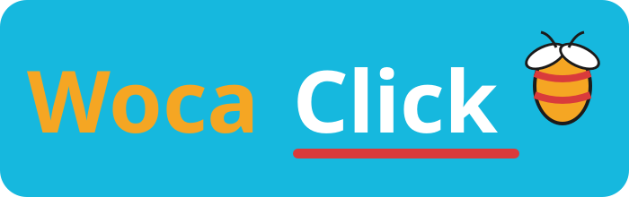

<p align="center">
  
</p>

> **Experimentální projekt.** WocaClick není určen k běžnému používání ani
> k získávání bodů. Slouží pouze k experimentování a testování. Používání je
> zcela na vlastní riziko a na vlastní odpovědnost. Přečti si
> [podmínky](TERMS.md) a [licenci](LICENSE).

# WocaClick

Moderní desktop nástroj pro procvičování **WocaBee** na **Fedora**. Běží
v jednom okně s vestavěným prohlížečem (QtWebEngine) – žádný Firefox,
Selenium ani instalace ovladačů.

## Proč WocaClick

Algoritmus WocaClick je navržený tak, aby jeho chování bylo **nerozpoznatelné
od lidské práce**:

- psaní po znacích včetně diakritiky (žádné hromadné vložení),
- trusted Qt vstupy (klik, klávesy i dvojklik mají `isTrusted: true`),
- žádný WebDriver/geckodriver, `navigator.webdriver` je `false`,
- normální Chrome user-agent, Chrome-like Client Hints a persistentní profil,
- viditelný animovaný kurzor a pulz při kliku,
- automatické odškrtávání kroků v bočním návodu,
- automatické zapnutí 2 WocaPoints při Startu, pokud ho zapomeneš,
- běh na pozadí (můžeš mezitím dělat něco jiného),
- lidské tempo: náhodné prodlevy mezi znaky, čtení zadání, delší pauzy a přestávky,
- jitter a objížďky myši, nepřesný cíl kliku a občasné viditelné přejetí,
- občasné překlepy s Backspace a ověřením správného textu,
- Start je povolený jen v režimu **Procvičit**; test, zkoušení nebo hra se
  zablokuje s hláškou o podvádění,
- po každých 160 správných odpovědích „Uložit a odejít“ → forward → 2 WocaPoints,
- kredity: 1 správné řešení = 1 kredit, serverový balance zařízení, jednorázové 8znakové kódy z admin panelu.

## Kredity

**1 správné řešení = 1 kredit.** Kredity se dobíjejí jednorázovým 8znakovým kódem,
který vytváří admin na **https://kuclab.org/wc/**. Kód lze použít pouze jednou
a admin u něj nastavuje počet kreditů. V aplikaci je v horní liště stav
**Kredity** a tlačítko **„Dobít“**. **Kódy vydávají pouze tvůrci aplikace;
od nikoho jiného je neber.** Zůstatek je na serveru podle zařízení;
aplikace ho před každou úlohou ověří a po správném řešení odečte.

## Stažení

Aktuální RPM pro **Fedora 44** je v
[Releases](https://github.com/Jerry256254/WocaClick/releases/latest):

```bash
sudo dnf install ./wocaclick-0.2.3-1.fc44.noarch.rpm
```

Závislosti (`python3-pyside6`, `qt6-qtwebengine`) se doinstalují automaticky.

## Stav projektu

RPM je vydané v Releases. Tento repozitář obsahuje informace o projektu,
branding a licenci; zdrojový kód aplikace není zveřejněný.

## Funkce

- vestavěný prohlížeč v jednom okně,
- ovládání Start/Stop, limit správných odpovědí, statistiky kliknutí,
- potvrzovací dialog s podmínkami při každém Startu,
- moderní tmavě/oranžový design a loading screen.

## Upozornění

WocaClick je experimentální software. Není určen k běžnému používání,
k podvádění, k získávání bodů ani k nahrazení výuky. Používání je zcela na
vlastní riziko a na vlastní odpovědnost. Nástroj může porušovat podmínky
WocaBee a vést k **zablokování účtu**. Autoři nenesou žádnou odpovědnost za
ztrátu účtu, body, data ani jiné škody; uživatel je plně odpovědný a odškodní
autory. Nástroj se nesmí upravovat, distribuovat ani prodávat. Žádný nástroj
nemůže garantovat 100% neodhalitelnost. Podrobnosti v [TERMS.md](TERMS.md).

## Licence

Vlastní implementace WocaClick je proprietary software – viz
[LICENSE](LICENSE). Původní projekt `wocabee-bot` je pod MIT licencí; jeho
notice je zachován v [LICENSE-MIT](LICENSE-MIT).

## Made by

[github.com/jerry256254](https://github.com/jerry256254)
